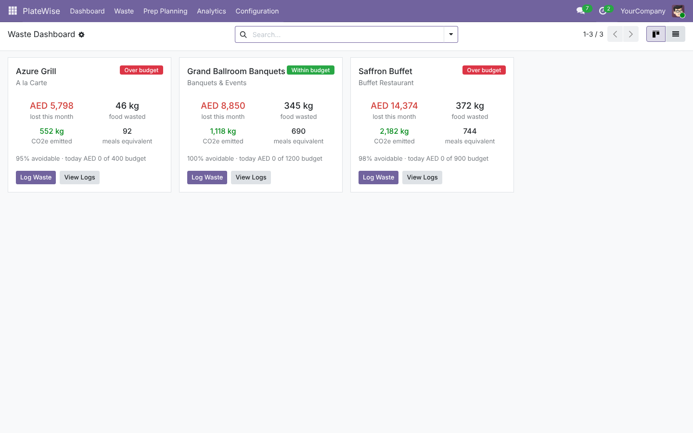
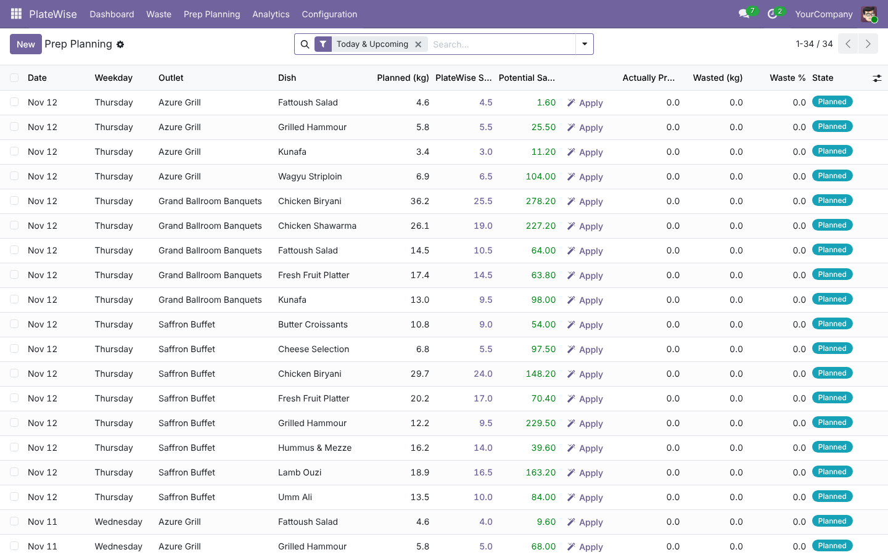
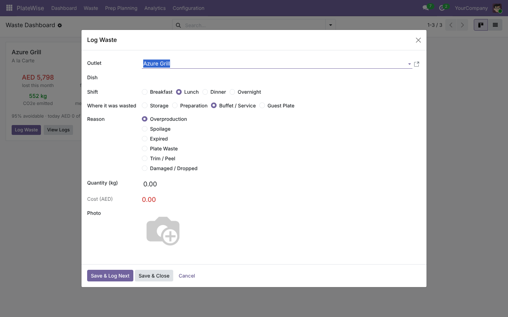
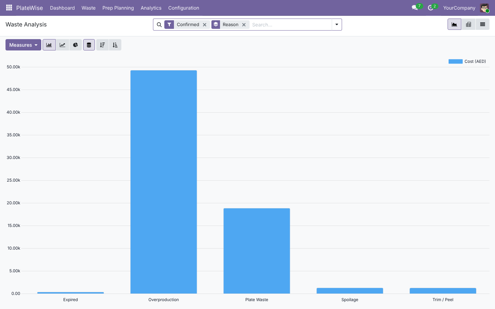

# PlateWise 🍽️
Food-waste tracking, costing and prep forecasting for hotel kitchens, built as an Odoo 19 app.

   

## Project Overview
Hotel kitchens in the UAE throw away food every day, but the waste is rarely weighed, priced or planned against, so it never shows up as a cost. PlateWise is an Odoo 19 module that lets kitchen staff log waste in a pop-up form, converts every entry into AED and kg CO2e, suggests tomorrow's prep quantities from past consumption, and alerts the outlet manager when an outlet goes over its daily waste budget. It was built in two days by a team of five for an Odoo hackathon in Dubai, and has been tested only on simulated data.

## Features
- **Quick waste logging:** a pop-up form with radio buttons for shift, stage and reason, a weight field, an optional photo, and a "Save & Log Next" button that keeps the outlet and shift filled in.
- **Automatic costing:** each entry's cost is `kg × dish cost per kg` (AED) and its emissions are `kg × food-category CO2e factor`; a dish's cost can be copied from a linked Odoo product.
- **Outlet dashboard:** one kanban card per outlet with this month's AED lost, kg wasted, kg CO2e, meals equivalent (0.5 kg per meal), avoidable share, today's loss and a Within / Near / Over budget badge.
- **Prep-planning forecast:** for each dish and outlet, averages the kg actually consumed (produced − wasted) on the same weekday over the last 4 weeks, adds a 5% buffer, rounds to 0.5 kg, and shows the AED saving against the planned quantity. One click applies it.
- **Nightly budget check:** a scheduled action compares each outlet's cost for the previous day with its budget, posts a note in the outlet's chatter naming the costliest item, and assigns a to-do to the outlet manager (once, not repeated while it is open).
- **Analytics:** graph and pivot views of waste cost and kg by outlet, reason, stage, shift, weekday, food category and dish.
- **Food donation flag:** untouched overproduction can be marked "Redirected to Donation"; plate waste is blocked from this.
- **Impact Report (PDF):** a monthly QWeb report per outlet with totals, cost by reason, the 5 costliest dishes, and the saving if avoidable waste were halved (the UAE Ne'ma 2030 target).
- **Sample data generator:** one menu item creates 3 outlets, 12 dishes and 28 days of prep plans and waste logs for demos.

## Tech Stack
| Layer | Tools |
| --- | --- |
| Framework | Odoo 19.0 (ORM, XML views, QWeb, scheduled actions) |
| Language | Python 3.10+ (as required by Odoo 19), XML |
| Database | PostgreSQL |
| Odoo dependencies | `base`, `mail` (chatter, activities, tracking), `product` |
| UI | Odoo kanban, list, form, pivot, graph and search views; no custom JavaScript |

## Screenshots / Demo
| Screenshot | What it shows |
| --- | --- |
|  | Outlet dashboard with monthly loss, CO2e and budget badges |
|  | Prep plans with PlateWise suggestions, potential savings and Apply buttons |
|  | Pop-up waste-logging form used on kitchen tablets |
|  | Waste cost by reason; overproduction is the largest category in the sample data |

Live demo: [add link]

## Installation
Requirements: a working Odoo 19 installation (Community or Enterprise) with Python 3.10+ and PostgreSQL. No API keys or external accounts are needed.

1. Clone the module into a folder that is on your Odoo `addons_path`.

   macOS / Linux:
   ```bash
   cd /path/to/your/custom/addons
   git clone https://github.com/fsafva13-coder/platewise.git
   ```
   Windows (PowerShell):
   ```powershell
   cd C:\path\to\your\custom\addons
   git clone https://github.com/fsafva13-coder/platewise.git
   ```
2. Restart Odoo and install the module from the command line:
   ```bash
   python odoo-bin -c odoo.conf -d <your_database> -i platewise
   ```
   Or restart Odoo, enable developer mode, open **Apps → Update Apps List**, search for **PlateWise** and click **Activate**.
3. Open **PlateWise → Configuration → Generate Sample Hotel Data** to load demo data. Databases created with demo data receive it automatically.

The PDF report needs `wkhtmltopdf`, which Odoo uses for all PDF reports.

## Usage / Examples
1. **Log waste:** on the Dashboard, click **Log Waste** on an outlet, choose the dish, stage, reason and weight, then **Save & Close**.
2. **Plan tomorrow:** open **Prep Planning** and click **Apply** next to a dish to replace the planned quantity with the suggestion.
3. **Review:** open **Analytics** for the breakdown, or an outlet's form for its chatter alerts and **Impact Report**.

Example (sample data):
- Input: Saffron Buffet, Lamb Ouzi (AED 68/kg, red meat factor 27 kg CO2e/kg), Overproduction, 2.5 kg.
- Output: a confirmed log costing **AED 170.00** and **67.5 kg CO2e**, marked avoidable, and the outlet's "Lost today" rises by AED 170.

## Project Structure
```
platewise/
├── __init__.py                  # imports the models package
├── __manifest__.py              # module metadata, dependencies, data files in load order
├── models/
│   ├── __init__.py              # imports the five model files
│   ├── food_category.py         # food groups with CO2e factors
│   ├── dish.py                  # menu items, cost per kg, optional product link
│   ├── outlet.py                # outlets, monthly KPIs, budget status, nightly check, report data
│   ├── waste_log.py             # waste entries: cost/CO2e, states, quick-save action
│   └── prep_plan.py             # daily prep plans, forecast logic, sample data generator
├── views/
│   ├── food_category_views.xml  # editable category list
│   ├── dish_views.xml           # dish list and form
│   ├── outlet_views.xml         # dashboard kanban, outlet list and form
│   ├── waste_log_views.xml      # list, form, quick form, kanban, pivot, graph, search
│   ├── prep_plan_views.xml      # editable prep list, form, search
│   └── platewise_menus.xml      # app menus
├── report/
│   └── outlet_report.xml        # Food Waste Impact Report (QWeb PDF)
├── data/
│   ├── platewise_data.xml       # categories, sequence, scheduled action, sample-data action
│   └── platewise_demo.xml       # runs the sample-data generator on demo databases
├── security/
│   └── ir.model.access.csv      # access rights for internal users
├── static/description/icon.png  # app icon
└── docs/                        # README screenshots
```

## Results / Metrics
All figures below come from the built-in sample data generator, not from a real hotel.

| Measure | Value |
| --- | --- |
| Sample data created per run | 3 outlets, 12 dishes, 28 days of history, 510 prep plans |
| Saffron Buffet, month to date (14 Nov 2026) | AED 18,942 lost, 478 kg wasted, 3,193 kg CO2e, 98% avoidable |
| Saffron Buffet, saving if avoidable waste were halved | AED 9,277 per month |
| Example forecast (Chicken Biryani, banquet outlet) | 36.2 kg planned → 25.5 kg suggested, AED 278 potential saving for one day |
| Install test | Installed without errors on a fresh Odoo 19 database, with and without demo data |

How they were produced: the generator simulates weekday demand (Friday ×1.5, Saturday ×1.35) against a fixed "habit" production quantity, using a fixed random seed. The month-to-date figures were read from the Impact Report on one test database.

Limitations: the data is simulated, so these numbers say nothing about real kitchens. The forecast is a simple 4-week same-weekday average, not a trained model. CO2e factors are indicative values. There are no automated tests yet, and amounts are labelled in AED regardless of the company currency.

## Challenges & Learnings
- **Forecasting from the wrong number.** Averaging what was *produced* would copy the kitchen's over-cooking habit, so the forecast averages what was *consumed* (produced − wasted). Learned to check what a baseline actually measures before predicting from it.
- **XML load order.** An action pointed to a view defined later in the same file, and the outlet form's button referenced a report loaded after it; both failed on install. Reordered the files in the manifest and within the XML. Learned that Odoo resolves references at load time, in manifest order.
- **Dashboard layout.** Fields placed inside kanban cards rendered as separate blocks and broke the number layout. Switched to QWeb `t-out` with the raw values and formatted them in the template.
- **Alert that "didn't work".** The budget alert stayed silent because the previous day was a Friday, when the sample data has the highest demand and the least waste. The logic was correct; for the demo we logged an over-budget entry and ran the scheduled action manually.
- **Duplicate alerts.** The scheduled action ran twice on one day and posted the alert twice. Added a check that skips outlets that already have an open review activity.
- **Sample data owner.** Records generated during install were assigned to the system bot instead of a real user, so the manager's to-dos went to the wrong place. The generator now assigns the administrator.

## Future Improvements
1. Automated tests for the cost, forecast and budget-check logic.
2. Read covers and sales from Odoo Point of Sale so the forecast uses real demand.
3. Post confirmed waste as Inventory scrap moves so stock and valuation stay correct.
4. Use the company currency instead of fixed AED labels.
5. Capture weight automatically from scales through the Odoo IoT Box.
6. Suggest the dish from the waste photo using image recognition.
7. A group dashboard comparing outlets across several hotels.


## License
LGPL-3. See the module manifest. Team: Madhurima, Safva, Neha, Asna and Liya.
